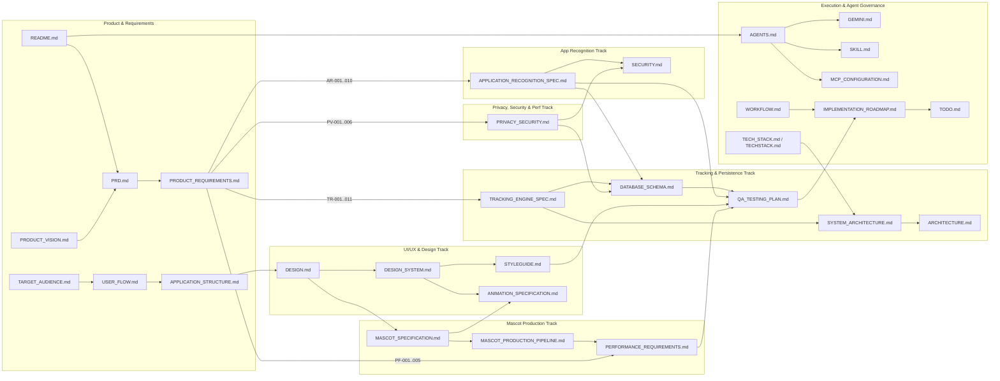

# Timo Project Comprehension & Blueprint Audit Report

**Repository:** `c:\TIMO`  
**Blueprint Location:** `c:\TIMO\docs\` (31 Markdown documents; note that the prompt references `Timo_Product_Blueprint`, which maps to `docs/` in this repository)  
**Repository State:** Fresh git repository on `main` (no commits yet; `docs/` untracked; no `src/`, `src-tauri/`, `package.json`, `Cargo.toml`, or `docs/adr/` present)  
**Audit Date:** 2026-11-17  
**Status Vocabulary:** **Approved** | **Recommended** | **Provisional** | **Future** | **Blocked**

---

## Section 1: Reading Completion Matrix

All 31 Markdown documents in `c:\TIMO\docs\` were opened and read in full (`StartLine: 1` through EOF). None were missing, unreadable, or truncated.

| # | Document | Status | Main Responsibility | Key Information Understood | Related Documents |
|---|---|---|---|---|---|
| 1 | [`README.md`](./README.md) | COMPLETED (lines 1-126) | Master blueprint index, governance, precedence, status vocabulary, boundaries | Defines Timo overview, 17-row decision table, 5-level source-of-truth precedence, 5-term decision vocabulary, non-negotiable boundaries, native PoC first milestone, and official external reference URLs. | All 30 docs; `PRD.md`, `WORKFLOW.md` |
| 2 | [`PRD.md`](./PRD.md) | COMPLETED (lines 1-151) | Core product requirements summary & scope boundaries | Covers problem statement, 7 goals, v1 non-goals, Windows 11 x64 vs best-effort Windows 10 (EOS Oct 14, 2025), Must/Should/Future scope, tracking definitions, 6-tier recognition precedence, local Windows greeting personalization, mascot/tech/privacy/perf baselines, success metrics, and release gate. | `README.md`, `PRODUCT_REQUIREMENTS.md`, `QA_TESTING_PLAN.md` |
| 3 | [`PRODUCT_VISION.md`](./PRODUCT_VISION.md) | COMPLETED (lines 1-48) | Vision, mission, emotional tone, brand voice, non-goals | Anchors non-judgmental reflection ("Awareness, not judgment", "Foreground truth", "Honest classification"), emotional experience, and warm plain-language brand voice without guilt or shaming. | `PRD.md`, `TARGET_AUDIENCE.md`, `DESIGN.md` |
| 4 | [`PRODUCT_REQUIREMENTS.md`](./PRODUCT_REQUIREMENTS.md) | COMPLETED (lines 1-80) | Testable requirements matrix with IDs, priorities, acceptance criteria | Formalizes P0/P1/P2 requirements: `TR-001` to `TR-011`, `AR-001` to `AR-010`, `UI-001` to `UI-010`, `PV-001` to `PV-006`, `PF-001` to `PF-005`, plus reconciliation and written-formula acceptance rules. | `TRACKING_ENGINE_SPEC.md`, `APPLICATION_RECOGNITION_SPEC.md`, `QA_TESTING_PLAN.md` |
| 5 | [`TARGET_AUDIENCE.md`](./TARGET_AUDIENCE.md) | COMPLETED (lines 1-60) | Audience segments, personas, non-assumptions, usability questions | Targets Students and Professionals/Creators (primary) plus General Desktop Users and Accessibility-conscious/less-technical users (secondary); bans inferring intent/harm from app type or assuming single-user Windows accounts; defines 5 usability research questions. | `PRODUCT_VISION.md`, `USER_FLOW.md`, `DESIGN_SYSTEM.md` |
| 6 | [`USER_FLOW.md`](./USER_FLOW.md) | COMPLETED (lines 1-70) | End-to-end journeys and failure/recovery flows | Specifies 7-step onboarding (with local Windows username suggestion & system readiness check), returning user flow, unknown-app review queue, app details, timeline, insights, 6 Settings groups, and 5 explicit failure/recovery flows. | `APPLICATION_STRUCTURE.md`, `PRIVACY_SECURITY.md`, `QA_TESTING_PLAN.md` |
| 7 | [`APPLICATION_STRUCTURE.md`](./APPLICATION_STRUCTURE.md) | COMPLETED (lines 1-73) | Information architecture, screen inventory, window & tray semantics | Mandates compact 5-item sidebar (`Overview`, `Timeline`, `Applications`, `Insights`, `Settings`) + nested `Application Details`; specifies per-screen elements, global status/toast/dialog rules, `980x640` minimum window target, explicit hide-to-tray vs Exit choice, and tray menu actions. | `USER_FLOW.md`, `DESIGN.md`, `SYSTEM_ARCHITECTURE.md` |
| 8 | [`DESIGN.md`](./DESIGN.md) | COMPLETED (lines 1-42) | Experience design, page composition, mascot placement, visual QA | Applies Soft Playful Neo-Brutalism per page (editorial Overview, chronological Timeline, organized Applications library, metric-first App Details, calm Settings), non-obstructive mascot rules, empty state copy guidance, and `100%/125%/150%` Windows scaling visual audit gates. | `DESIGN_SYSTEM.md`, `STYLEGUIDE.md`, `MASCOT_SPECIFICATION.md` |
| 9 | [`DESIGN_SYSTEM.md`](./DESIGN_SYSTEM.md) | COMPLETED (lines 1-98) | Provisional tokens, category colors, typography, components, a11y | Defines 8 neutral and 6 accent provisional hex values (explicitly requiring WCAG 2.2 AA validation), 6 category color mappings (+ icon/label/pattern redundancy), typography (`Plus Jakarta Sans`/`Nunito Sans`, `Space Grotesk`, `JetBrains Mono`, tabular numerals), 18 core shadcn/Radix components, intentional dark theme rule, and WCAG 2.2 AA checklist. | `DESIGN.md`, `STYLEGUIDE.md`, `ANIMATION_SPECIFICATION.md` |
| 10 | [`STYLEGUIDE.md`](./STYLEGUIDE.md) | COMPLETED (lines 1-57) | Frontend coding, CSS variable, data display, and interaction rules | Enforces semantic tokens, PascalCase/`use*`/`snake_case` naming, no CSS leak selectors, Lucide-only icons (no emoji primary icons, no SVG mascot fake), `2h 15m` duration formatting, destructive confirmations, and 7-point UI review checklist. | `DESIGN_SYSTEM.md`, `TECH_STACK.md`, `AGENTS.md` |
| 11 | [`MASCOT_SPECIFICATION.md`](./MASCOT_SPECIFICATION.md) | COMPLETED (lines 1-69) | 3D fantasy companion spec, clips, interaction, acceptance | Defines original rounded/compact fantasy creature in blue/lavender + mint/cream matte PBR palette, 6 concept expressions, 10 named animation clips, clamped cursor look, touch fallback, and mandatory GLB + preview render acceptance gate. | `MASCOT_PRODUCTION_PIPELINE.md`, `ANIMATION_SPECIFICATION.md`, `DESIGN.md` |
| 12 | [`MASCOT_PRODUCTION_PIPELINE.md`](./MASCOT_PRODUCTION_PIPELINE.md) | COMPLETED (lines 1-77) | AI-agent-owned 8-stage concept-to-GLB production workflow | Assigns full concept, multi-view turnaround, 3D generation (Tripo/Meshy), headless Blender refinement, anatomy-appropriate rigging, animation, `mascot_manifest.json` + GLB export, and R3F integration to the AI agent (user never uses Blender); notes Tripo rig compatibility check and license/secret handling. | `MASCOT_SPECIFICATION.md`, `ANIMATION_SPECIFICATION.md`, `TODO.md` |
| 13 | [`ANIMATION_SPECIFICATION.md`](./ANIMATION_SPECIFICATION.md) | COMPLETED (lines 1-65) | Motion for React timings, mascot state machine, GPU pause rules | Sets timing bands (120-180ms micro to 250-500ms data reveal), mandates Motion for React + CSS hovers, specifies 7 mascot states (`hidden`, `idle`, `greeting`, `curious`, `happy`, `relaxed`, `celebrating`), rate-limiting/debouncing, and pausing WebGL when hidden/minimized/tray/offscreen/reduced-motion. | `MASCOT_SPECIFICATION.md`, `DESIGN_SYSTEM.md`, `PERFORMANCE_REQUIREMENTS.md` |
| 14 | [`TECH_STACK.md`](./TECH_STACK.md) | COMPLETED (lines 1-59) | Detailed stack choices, candidate Rust crates, plugins, version policy | Specifies Tauri 2, Rust (`windows`, `rusqlite`, `serde`, `thiserror`/`anyhow`, `tracing`, `crossbeam-channel`/Tokio), dedicated WinEvent thread, React+TS+Vite+Tailwind+shadcn/Radix+Motion+Recharts+R3F/Drei+Zustand+TanStack Table/Virtual+date-fns+Lucide+Zod, Rust-only SQLite, NSIS installer, and Context7/official version pinning. | `TECHSTACK.md`, `SYSTEM_ARCHITECTURE.md`, `MCP_CONFIGURATION.md` |
| 15 | [`TECHSTACK.md`](./TECHSTACK.md) | COMPLETED (lines 1-32) | Quick-reference technology table and 6 agent constraints | Summarizes approved layers; uniquely specifies **Custom CSS Grid/SVG component** for `Timeline` (rather than Recharts) and reiterates 6 strict stack rules for agents. | `TECH_STACK.md`, `ARCHITECTURE.md`, `APPLICATION_STRUCTURE.md` |
| 16 | [`SYSTEM_ARCHITECTURE.md`](./SYSTEM_ARCHITECTURE.md) | COMPLETED (lines 1-96) | Runtime boundaries, threading, failure handling, lifecycle, security | Includes runtime Mermaid dataflow, 6 component boundaries, 4-role threading model (single serialized tracking coordinator), failure/recovery policies, tray/quit lifecycle, and renderer-to-Rust security boundaries. | `ARCHITECTURE.md`, `TRACKING_ENGINE_SPEC.md`, `SECURITY.md` |
| 17 | [`ARCHITECTURE.md`](./ARCHITECTURE.md) | COMPLETED (lines 1-84) | Modular monolith structure, dependency direction, state ownership, ADRs | Defines `/src-tauri/src/{app,commands,database,platform/windows,tracking,recognition,settings,telemetry}` and `/src/{app,components,features/*,hooks,lib,styles,types}`, strict inward dependency rules, state ownership split, user-safe error model, and 6 ADR triggers in `docs/adr/`. | `SYSTEM_ARCHITECTURE.md`, `TECH_STACK.md`, `WORKFLOW.md` |
| 18 | [`TRACKING_ENGINE_SPEC.md`](./TRACKING_ENGINE_SPEC.md) | COMPLETED (lines 1-107) | Windows event strategy, state machine, monotonic timing, recovery | Specifies `SetWinEventHook(EVENT_SYSTEM_FOREGROUND)`, `GetLastInputInfo` (~1 Hz idle check, 5-min default), `WTSRegisterSessionNotification`, `WM_POWERBROADCAST`, 6-state FSM (`STOPPED`, `TRACKING_APP`, `IDLE`, `LOCKED`, `SUSPENDED`, `ERROR`), monotonic vs UTC accounting, 75-150ms debounce, passive media caveat, checkpoint crash recovery, and 12-case test matrix. | `PRODUCT_REQUIREMENTS.md`, `DATABASE_SCHEMA.md`, `QA_TESTING_PLAN.md` |
| 19 | [`APPLICATION_RECOGNITION_SPEC.md`](./APPLICATION_RECOGNITION_SPEC.md) | COMPLETED (lines 1-94) | Evidence sources, 7-tier precedence, identity, launchers, confidence | Covers PE version metadata, digital signature, AUMID/package family, Steam/Epic manifests, 7-tier precedence, PID+creation-time instance identity, 6 categories + 7 app roles, 5 evidence states (`confirmed_user`..`unknown`), launcher vs foreground game isolation, browser ambiguity, untrusted-input parsing rules, and labeled corpus testing. | `TRACKING_ENGINE_SPEC.md`, `DATABASE_SCHEMA.md`, `SECURITY.md` |
| 20 | [`DATABASE_SCHEMA.md`](./DATABASE_SCHEMA.md) | COMPLETED (lines 1-94) | SQLite tables, indexes, integrity invariants, retention & export | Defines 7 tables (`applications`, `categories`, `usage_sessions`, `activity_events`, `classification_evidence`, `user_preferences`, `schema_migrations`), foreign keys, 5 index targets, `duration_ms >= 0`, midnight model constraint (pick write-time or query-time, never mix), and redacted-by-default export. | `SYSTEM_ARCHITECTURE.md`, `TRACKING_ENGINE_SPEC.md`, `PRIVACY_SECURITY.md` |
| 21 | [`PRIVACY_SECURITY.md`](./PRIVACY_SECURITY.md) | COMPLETED (lines 1-60) | Privacy boundaries, local-first guarantees, personalization, controls | Lists collected vs explicitly uncollected data (no keystrokes, screenshots, clipboard, URLs/tabs, comms, cloud accounts), offline capability, safe local Windows username suggestion, 8 user data controls, transparency caveats, and 7-point pre-release privacy checklist. | `SECURITY.md`, `DATABASE_SCHEMA.md`, `PRD.md` |
| 22 | [`SECURITY.md`](./SECURITY.md) | COMPLETED (lines 1-77) | Threat model, defensive controls, security testing, incident response | Protects local history, credentials, and keys against malformed EXEs, path traversal, renderer compromise, SQL injection, log leaks, tampered updates, and DB corruption; enforces parameterized SQL, zero shell interpolation, CSP/least privilege, redaction, and fuzz/path testing. | `PRIVACY_SECURITY.md`, `SYSTEM_ARCHITECTURE.md`, `APPLICATION_RECOGNITION_SPEC.md` |
| 23 | [`PERFORMANCE_REQUIREMENTS.md`](./PERFORMANCE_REQUIREMENTS.md) | COMPLETED (lines 1-47) | Provisional RAM/CPU budgets, optimization patterns, benchmark protocol | Sets provisional targets (`<=100 MB` tray RAM, `<=150 MB` visible overview RAM, ~0% 5-min idle CPU) on Windows 11 8GB/16GB reference hardware, requires separate Rust + WebView2 measurement across 3+ runs (median + max), and forbids sacrificing tracking correctness for speed. | `TECH_STACK.md`, `ANIMATION_SPECIFICATION.md`, `QA_TESTING_PLAN.md` |
| 24 | [`QA_TESTING_PLAN.md`](./QA_TESTING_PLAN.md) | COMPLETED (lines 1-75) | Multi-layer test plan, 15 critical scenarios (`QA-001`..`015`), release gate | Covers Rust unit, Windows native integration, and UI/Playwright tests; enumerates `QA-001` to `QA-015`, labeled recognition corpus, scaling/a11y checks (`100%/125%/150%`, `980x640`), performance report gate, and strict release gate criteria. | `PRODUCT_REQUIREMENTS.md`, `TRACKING_ENGINE_SPEC.md`, `PERFORMANCE_REQUIREMENTS.md` |
| 25 | [`AGENTS.md`](./AGENTS.md) | COMPLETED (lines 1-61) | Repository-wide engineering, UI, mascot, MCP, and reporting rules | Consolidates mandatory orientation steps, non-negotiable decisions, Rust/SQL/UI/mascot ownership rules, Context7/Playwright/no-Figma rules, and factual completion reporting requirements. | `GEMINI.md`, `SKILL.md`, `WORKFLOW.md` |
| 26 | [`GEMINI.md`](./GEMINI.md) | COMPLETED (lines 1-38) | Antigravity Gemini-specific role, quality, and anti-fabrication rules | Reinforces multi-role responsibility, skill honesty, tracking-before-polish priority, non-generic Soft Playful Neo-Brutalist UI, agent-owned mascot execution, and zero fabricated build/test/asset claims. | `AGENTS.md`, `SKILL.md`, `WORKFLOW.md` |
| 27 | [`SKILL.md`](./SKILL.md) | COMPLETED (lines 1-43) | Mandatory Antigravity skill discovery, application, and logging policy | Requires inspecting actual installed skills, reading complete `SKILL.md` + references, applying methodologies, maintaining `docs/SKILL_UTILIZATION.md` with 7 mandatory fields, and reporting missing skills honestly. | `AGENTS.md`, `GEMINI.md`, `TODO.md` |
| 28 | [`MCP_CONFIGURATION.md`](./MCP_CONFIGURATION.md) | COMPLETED (lines 1-41) | Approved, optional, conditional, and excluded MCP integrations | Designates Context7 and Playwright MCP as required, GitHub optional, Figma explicitly excluded, headless Blender/Tripo/Meshy as conditional external tools, and bans sending local paths/activity records to remote MCPs. | `TECH_STACK.md`, `AGENTS.md`, `QA_TESTING_PLAN.md` |
| 29 | [`WORKFLOW.md`](./WORKFLOW.md) | COMPLETED (lines 1-48) | 10-step docs-first workflow, DoR/DoD, branching, quality gates | Defines Orient -> Skills -> Scope -> Research -> Plan -> Implement -> Verify -> Review -> Document -> Report loop, Definition of Ready/Done, feature branch hygiene, and per-area quality gates. | `AGENTS.md`, `IMPLEMENTATION_ROADMAP.md`, `TODO.md` |
| 30 | [`TODO.md`](./TODO.md) | COMPLETED (lines 1-73) | Phase 0-6 actionable project checklist (currently 0/56 checked) | Tracks all deliverables from repository setup (`Phase 0`) through PoC tracking (`1`), recognition (`2`), UI MVP (`3`), polish (`4`), mascot (`5`), and release (`6`). Checkboxes remain strictly unchecked until repo/test evidence exists. | `IMPLEMENTATION_ROADMAP.md`, `WORKFLOW.md`, `QA_TESTING_PLAN.md` |
| 31 | [`IMPLEMENTATION_ROADMAP.md`](./IMPLEMENTATION_ROADMAP.md) | COMPLETED (lines 1-88) | Staged delivery roadmap with exit gates and future phase backlog | Sequences delivery (`Phase 0` to `Phase 6` + `Future phases`) with explicit exit gates enforcing that native tracking passes before full UI work begins. | `TODO.md`, `WORKFLOW.md`, `README.md` |

---

## Section 2: Product Understanding

### What Timo Is & Problem Solved
Timo is a local-first, privacy-first **Windows Digital Wellbeing desktop application** built to give users a truthful, calm understanding of how their computer time is distributed across applications. Desktop operating systems expose raw running processes, which count background music players, launchers, updaters, and idle open windows, or provide simplistic total screen-on timers that obscure what happened during the day. Manual time logs require constant discipline and break quickly. Timo resolves this by combining native, event-driven foreground window tracking with Windows idle/lock/sleep awareness and multi-signal application recognition, turning raw desktop intervals into clear timelines, application breakdowns, and multi-day reflections.

### Intended Users
Defined in [`TARGET_AUDIENCE.md`](./TARGET_AUDIENCE.md) and [`PRD.md`](./PRD.md):
- **Primary segments:**
  1. **Students:** managing mixed study, browsing, media, and gaming sessions without shame-based productivity scoring.
  2. **Professionals & Creators** (developers, designers, editors, freelancers, office workers): needing accurate per-tool session boundaries, date ranges, timelines, and exportable logs.
- **Secondary & inclusivity segments:**
  3. **General desktop users:** needing plain-language categories and clear visuals without knowing `.exe` names or filesystem internals.
  4. **Older or less technical / accessibility-conscious users:** requiring generous text sizing, high contrast, predictable non-hidden controls, keyboard navigation, Windows scaling compatibility, and reduced-motion support.

### Product Goals & Core Value Proposition
1. **Foreground Truth:** Only count the eligible foreground application actively receiving user engagement; never credit background apps (e.g., background Spotify or Steam launcher behind a running game).
2. **Inflation Prevention:** Detect idle thresholds, Windows lock/unlock, sleep/hibernate/resume, app exits, crashes, and midnight transitions using monotonic timing so active durations are never inflated.
3. **Resilient App Recognition:** Identify Microsoft Store/UWP packaged apps, Steam/Epic games, conventional installers, portable apps, and standalone `.exe` binaries via layered evidence, defaulting honestly to `Unknown / Needs Review` rather than guessing.
4. **Non-Judgmental Tone:** Present neutral, reflective insights ("You spent 2h 15m in Chrome") without productivity scores, scolding, or punitive limits in v1.
5. **Local-First & Resource-Conscious:** Zero accounts, zero cloud telemetry, and measurable low steady-state background overhead.

### Product Boundaries & Non-Goals (v1)
Explicitly outside Timo v1 (`PRD.md` §4, `PRODUCT_VISION.md`, `PRIVACY_SECURITY.md`):
- No macOS or Linux builds (though OS-specific code sits behind `platform::windows` for future portability).
- No accounts, login walls, cloud sync, social feeds, or leaderboards.
- No keystroke logging, screenshots, webcam/mic access, clipboard/document inspection, or browser URL/tab/search-history collection.
- No employee surveillance, parental monitoring, app blocking, hard time limits, or process-killing features.
- No remote AI/LLM classification sending executable paths or usage telemetry off-device.
- No focus timers, break reminders, goal streaks, or advanced media-session playback awareness in v1 (tracked under **Future**).

### Decision Classification Status
Using the blueprint's mandatory 5-term vocabulary (`README.md` §5):
- **Approved:** Product name **Timo**; Official tagline **"A little clarity for your digital day."** (**APPROVED — OWNER DECISION** in Phase 0); Digital Wellbeing Windows desktop category; Windows 11 x64 primary target; no login/cloud sync in v1; local-first SQLite owned exclusively by Rust; foreground-only tracking with idle/lock/sleep/resume/switch/midnight/crash-recovery handling and Timo UI exclusion; evidence-based recognition distinguishing launchers from games with user overrides; 5 top-level pages (`Overview`, `Timeline`, `Applications`, `Insights`, `Settings`) + nested `Application Details`; local Windows username onboarding suggestion with editable display name; **Soft Playful Neo-Brutalism** design identity; original rigged/animated 3D fantasy creature mascot owned end-to-end by the AI pipeline (owner does not operate Blender); Tauri 2 + Rust + React + TS + Vite + Tailwind + SQLite + shadcn/Radix + Motion + Recharts + Lucide + Three.js/R3F/Drei; Context7 + Playwright required MCPs, GitHub optional, Figma MCP excluded.
- **Recommended:** `Plus Jakarta Sans` primary UI font; `rusqlite` crate; `Timeline` as custom CSS Grid/SVG component (`TECHSTACK.md`); `Launch at login` opt-in; NSIS initial installer; Application Review Queue inside Applications; initial milestone being native tracking PoC before dashboard UI; canonical unsplit UTC sessions + query-time splitting (`ADR-001`); neutral browser default (`ADR-003`); deterministic `stable_app_key`, UWP/elevated fallback, and 30s checkpoints (`ADR-006`).
- **Provisional:** `5-minute` default idle threshold (`TR-010`); `75-150 ms` foreground debounce window and `~1s` idle sampling cadence (`TRACKING_ENGINE_SPEC.md`); `980x640` minimum logical window target; provisional hex palette in `DESIGN_SYSTEM.md` (untested in dark mode and partially failing WCAG AA in inverse/non-text pairs); animation duration bands in `ANIMATION_SPECIFICATION.md`; `<=100 MB` tray RAM, `<=150 MB` visible dashboard RAM, and `~0%` idle CPU targets (`PERFORMANCE_REQUIREMENTS.md`).
- **Future:** Focus sessions, user-defined goals, break reminders, app limits, media-session playback awareness (preventing video watching from registering idle), cloud sync, macOS/Linux ports, MSI installer, and signed auto-updater (`TECH_STACK.md` / `SECURITY.md` hold updater until signing keys exist).
- **Blocked:** Signed updater (no signing key/release infra yet); Context7 and Playwright MCP workflows in this exact session (neither MCP server is active in `<mcp_servers>`); automated 3D mascot production stages 3-7 (no Blender CLI/3D skill or verified Tripo/Meshy API key/credits confirmed in this environment yet).

---

## Section 3: Feature Understanding

| Feature | Purpose | Expected Behavior | Key Dependencies | Spec Documents & Requirement IDs |
|---|---|---|---|---|
| **Overview** | Today-at-a-glance daily summary | Greets user by saved local display name; emphasizes today's total active foreground usage; displays idle time separately; shows top apps, category breakdown, short timeline preview, tracking status indicator (text+icon), and last-update timestamp. Shows honest onboarding/empty state with zero fabricated numbers before sessions arrive. | Rust session/summary queries, Preferences, Tracking Status events, optional contextual Mascot | `APPLICATION_STRUCTURE.md`, `DESIGN.md`, `USER_FLOW.md`, `PRODUCT_REQUIREMENTS.md` (`UI-001`, `UI-002`) |
| **Automatic Tracking** | Accurate foreground usage collection | Listens passively via WinEvent hook (`EVENT_SYSTEM_FOREGROUND`) on dedicated native thread; filters Timo UI and excluded shell/apps; closes previous session and starts next in a single coordinator transaction; works continuously when dashboard is closed/minimized to tray (unless user chose Quit or Pause). | `platform::windows`, Tracking Coordinator, SQLite `usage_sessions`, Tray lifecycle | `TRACKING_ENGINE_SPEC.md`, `SYSTEM_ARCHITECTURE.md`, `PRODUCT_REQUIREMENTS.md` (`TR-001`..`004`, `TR-008`, `TR-009`, `TR-011`, `PF-001`, `PF-002`) |
| **Idle / Lock / Sleep Detection** | Eliminate false inflation when away or asleep | Polls `GetLastInputInfo` at low cadence (~1 Hz) to pause app tracking when input gap crosses configurable threshold (5m default); registers Windows session lock/unlock (`WTSRegisterSessionNotification`) and power suspend/resume (`WM_POWERBROADCAST`); emits distinct `activity_events` and re-queries foreground on resume/unlock. Includes transparent passive-media caveat. | Windows session/power notification window, Tracking State Machine, SQLite `activity_events`, Preferences | `TRACKING_ENGINE_SPEC.md`, `DATABASE_SCHEMA.md`, `PRIVACY_SECURITY.md`, `PRODUCT_REQUIREMENTS.md` (`TR-005`..`007`, `TR-010`, `PF-003`) |
| **Application Recognition** | Turn raw HWNDs/EXEs into stable named apps | Inspects process creation identity (avoiding PID reuse), normalized path, PE version resources, digital signature, AUMID/Package Family Name, and Steam/Epic manifests defensively without executing binaries; assigns stable `applications.id` and `app_type` (`game`, `game launcher`, `browser`, etc.). | Windows process/package APIs, Safe PE/manifest parsers, SQLite `applications` | `APPLICATION_RECOGNITION_SPEC.md`, `SECURITY.md`, `PRODUCT_REQUIREMENTS.md` (`AR-001`..`006`, `AR-010`) |
| **Smart Categorization** | Group apps meaningfully with honest certainty | Applies 7-tier precedence (`confirmed_user` > curated/package > strong metadata > launcher manifest > verified install > filename heuristic > `unknown`); tags `classification_state` and `source_rule_id` in `classification_evidence`; never treats unknown EXEs as games by filename or browsers as purely productive. | Curated local rule table, Recognition Engine, SQLite `categories` & `classification_evidence` | `APPLICATION_RECOGNITION_SPEC.md`, `PRD.md`, `DATABASE_SCHEMA.md`, `PRODUCT_REQUIREMENTS.md` (`AR-007`..`009`) |
| **Application Review Center** | User resolution of unknown/low-confidence apps | Surfaces apps in `Others / Uncategorized` or `low`/`unknown` confidence inside `Applications` (without ever blocking tracking); displays available evidence (app name, exe name, publisher, source) and lets user pick a category or keep unknown, persisting a high-priority override. | `Applications` page / `AppReviewDialog`, `classification_evidence`, Tauri category override command | `USER_FLOW.md` (§3), `APPLICATION_STRUCTURE.md`, `DESIGN_SYSTEM.md`, `PRODUCT_REQUIREMENTS.md` (`AR-008`, `AR-009`, `UI-008`) |
| **Application Details** | Deep inspection & control for one app | Nested view reached from `Applications`, `Overview`, or `Timeline`; shows app identity/metadata, category + evidence/confidence provenance, today/week/custom range totals, average daily use, last used, chronological session history, category editor, reset-to-automatic button, and track/exclude toggle. | Route params (`application_id`), session history query, override/exclusion commands | `APPLICATION_STRUCTURE.md`, `USER_FLOW.md` (§4), `PRODUCT_REQUIREMENTS.md` (`UI-004`, `UI-005`) |
| **Usage Timeline** | Chronological reconstruction of a day | Date selector (`Today` or past local date), category/app filters, custom CSS Grid/SVG timeline showing non-overlapping active app blocks (category accent + non-color cues), visually distinct idle blocks, and lock/sleep interruption markers; handles midnight splits and clicking a block navigates to Application Details. | Custom CSS Grid/SVG `UsageTimeline`, `usage_sessions` + `activity_events` queries, timezone/midnight split logic | `APPLICATION_STRUCTURE.md`, `USER_FLOW.md` (§5), `TECHSTACK.md`, `PRODUCT_REQUIREMENTS.md` (`UI-006`) |
| **Insights** | Multi-day weekly/monthly pattern reflection | Period selector (daily/weekly/monthly); renders total active trend, category distribution, top apps, and day-of-week patterns via Recharts with explicit units, timezone context, metric formula tooltips, valid-data comparison guards, and zero shaming language. | Recharts, query-level SQL aggregations, explicit metric formulas | `APPLICATION_STRUCTURE.md`, `USER_FLOW.md` (§6), `DESIGN.md`, `PRODUCT_REQUIREMENTS.md` (`UI-007`) |
| **Settings** | User preferences, privacy, & lifecycle controls | Six organized sections: General (greeting name, launch-at-login opt-in, hide-to-tray vs exit behavior), Tracking (idle threshold, pause/resume, excluded apps), Categories (overrides & reset), Appearance (light/dark/system, reduced motion, text scaling), Privacy & Data (DB location, export with default path redaction, delete history/metadata with confirmation), About (version, redacted diagnostics, licenses, privacy summary). | `user_preferences`, Tauri `autostart` evaluation, Export/Delete Rust commands, confirmation dialogs | `USER_FLOW.md` (§7), `APPLICATION_STRUCTURE.md`, `PRIVACY_SECURITY.md`, `PRODUCT_REQUIREMENTS.md` (`PV-005`, `PV-006`, `UI-010`) |
| **User Personalization** | Friendly local greeting without login | During first-run onboarding, reads Windows account username locally via Rust as a non-mandatory greeting suggestion; user confirms, edits, or skips; saves only `display_name` in local `user_preferences`; falls back gracefully to neutral greeting when unavailable; never transmits account identity. | Windows local user query, Onboarding flow, `user_preferences.display_name` | `PRD.md` (§11), `USER_FLOW.md` (§1), `PRIVACY_SECURITY.md`, `PRODUCT_REQUIREMENTS.md` (`UI-009`) |

---

## Section 4: Tracking Engine Understanding

The Windows tracking engine (`TRACKING_ENGINE_SPEC.md`, `SYSTEM_ARCHITECTURE.md`, `DATABASE_SCHEMA.md`) operates entirely in Rust behind the `platform::windows` adapter and feeds a single serialized **Tracking Coordinator** state machine (`STOPPED`, `TRACKING_APP(app_identity)`, `IDLE(last_foreground_app?)`, `LOCKED`, `SUSPENDED`, `ERROR`).

### End-to-End Lifecycle
1. **Foreground Event Detection:** A dedicated native thread hosts a Windows message pump and registers `SetWinEventHook` for `EVENT_SYSTEM_FOREGROUND` (`WINEVENT_OUTOFCONTEXT`). On startup and resume/unlock, the adapter also queries the initial active foreground HWND so tracking starts immediately without waiting for the next switch.
2. **HWND to Process Instance Identity:** Given a valid foreground `HWND`, Rust calls `GetWindowThreadProcessId` to get the `PID`, then obtains process creation timestamp (`GetProcessTimes` via limited query handle) + executable/package evidence. Pairing `(PID, process_started_at_utc)` prevents Windows PID reuse from falsely merging distinct processes (`TR-002`).
3. **Debounce & Surface Filtering:** Rapid Alt+Tab or transient helper popups pass through a provisional `75-150 ms` stability check (`TRACKING_ENGINE_SPEC.md` §6). Windows belonging to Timo itself (unless user disables default exclusion), invalid/invisible HWNDs, and known transient shell overlays are filtered; foreground transitions to excluded surfaces close the active app session without opening a new one. Note the explicit rule against naively discarding UWP hosts (`ApplicationFrameHost.exe` must resolve child core package identity).
4. **Application Switching & Session Persistence:** Switching from eligible App A to eligible App B triggers an atomic coordinator transition inside a SQLite transaction (`DATABASE_SCHEMA.md` §"Data integrity"): App A's `usage_sessions` row receives `ended_at_utc` and monotonic `duration_ms`, and App B's row opens (`started_at_utc`, `ended_at_utc = NULL` only while active). Background apps never accumulate sessions (`TR-004`).
5. **Idle Detection:** A low-frequency timer (~1s initial recommendation) queries `GetLastInputInfo` and handles 32-bit `GetTickCount` wraparound safely. When elapsed inactivity crosses `idle_threshold_seconds` (5 min provisional default), the coordinator closes the active app session at the policy boundary, logs `idle_started` in `activity_events`, and transitions to `IDLE`. When fresh input arrives while `IDLE`, it logs `idle_ended`, re-queries the current foreground HWND, and opens a fresh eligible `TRACKING_APP` session (`QA-005`).
6. **Lock & Unlock:** Via `WTSRegisterSessionNotification` on the adapter's message window, session lock (`WTS_SESSION_LOCK`) immediately closes any open `TRACKING_APP` or `IDLE` interval, logs `locked`, and transitions to `LOCKED`. Unlock (`WTS_SESSION_UNLOCK`) logs `unlocked`, evaluates last input + foreground HWND, and enters `TRACKING_APP` or `IDLE`.
7. **Sleep / Hibernate & Resume:** Via `WM_POWERBROADCAST` (`PBT_APMSUSPEND`, `PBT_APMRESUMEAUTOMATIC` / `PBT_APMRESUMESUSPEND`), suspend immediately flushes and closes the active interval, logs `suspended`, and enters `SUSPENDED`. On resume, the coordinator resets its monotonic baseline, re-validates/re-initializes WinEvent hooks if needed, queries current foreground, logs `resumed`, and begins a clean interval. Sleep duration is strictly excluded (`QA-007`).
8. **Monotonic Timing vs Wall-Clock Storage:** Elapsed `duration_ms` is always computed from a monotonic clock (`std::time::Instant` / QueryPerformanceCounter), never by subtracting wall-clock timestamps, protecting durations against NTP jumps, manual clock edits, or DST changes (`TRACKING_ENGINE_SPEC.md` §5). UTC ISO-8601 (`started_at_utc`, `ended_at_utc`) and `timezone_id` are stored for human reporting.
9. **Midnight Boundaries:** Either write-time splitting (closing at `23:59:59.999` local and reopening at `00:00:00.000` with updated `local_date`) or canonical query-time splitting must be chosen exclusively (`DATABASE_SCHEMA.md` lines 48-52 forbids mixing both).
10. **Restart / Crash Recovery:** During active sessions, the engine maintains a monotonic/wall-clock checkpoint. On unexpected crash/power-loss restart, startup detects any orphaned `usage_sessions` row with `ended_at_utc IS NULL` and closes it at the **last reliable checkpoint** (never at the new startup timestamp, preventing offline downtime from inflating active use).

### Technical Questions Requiring Phase 1 Validation
- **Idle Policy Boundary:** Should `IDLE` end the prior `TRACKING_APP` session retroactively at `last_input_time`, or at the threshold crossing timestamp (`T + idle_threshold`)? (See Section 12).
- **Checkpoint Mechanism:** Should crash recovery update the open `usage_sessions` row periodically (e.g., every 30-60s via WAL) or write to a lightweight checkpoint store?
- **Elevated Windows (UIPI) & Anti-Cheat Games:** When an administrator process or kernel anti-cheat game holds foreground, `SetWinEventHook` notifies HWND changes, but `OpenProcess` / PE metadata reads can return `ERROR_ACCESS_DENIED`. Exact fallback capture (window/process partial evidence vs fallback error handling) needs Phase 1 Windows 11 testing.
- **UWP / `ApplicationFrameHost.exe` Child Resolution:** Validating exact Win32/WinRT child window enumeration (`EnumChildWindows` + `GetPackageFamilyName` / `AppUserModelId`) for Store apps, including minimized/suspended UWP states.
- **WebView2 Tray Memory vs Hook Lifecycle:** Confirming hook stability when destroying vs hiding the Tauri frontend window to meet `<=100 MB` tray memory.

---

## Section 5: Application Recognition Understanding

The recognition pipeline (`APPLICATION_RECOGNITION_SPEC.md`, `DATABASE_SCHEMA.md`, `SECURITY.md`) runs defensively in Rust, treating every string, path, PE header, and manifest as **untrusted input** (zero binary execution, zero shell interpolation, zero full-disk crawling).

### Evidence Collection (Metadata-Only)
1. **Process & Package Identity:** `PID` + `process_started_at_utc`, normalized executable path & basename, and Windows Package Family Name / `AUMID` for Store/packaged apps.
2. **PE Version Resource & Digital Signature:** `ProductName`, `FileDescription`, `CompanyName` / publisher, `FileVersion`/`ProductVersion`, plus Authenticode signer publisher where practical.
3. **Installed Registry / Shortcut & Platform Manifests:** Safely readable uninstall metadata and Steam (`.acf` app manifests / `libraryfolders.vdf`) or Epic Games (`.item` manifest JSONs) metadata.

### Identity & Precedence Model
- **Stable App Identity (`applications.id`):** Keyed stably by `package_family_name`/`aumid` when packaged, otherwise by normalized executable identity (never `PID`). Note that full paths may expose Windows usernames (`C:\Users\<name>\...`), so paths stay local-only, never appear in ordinary UI, and are redacted from diagnostic/default exports.
- **7-Tier Classification Precedence:**
  1. Explicit user override (`confirmed_user`): always wins until user clicks Reset.
  2. Exact package identity / curated application database match (`high`).
  3. Strong product + publisher + executable identity agreement (`medium`/`high`).
  4. Launcher / platform manifest match (`medium`).
  5. Verified installation metadata + normalized file path (`medium`).
  6. Filename / path heuristic (`low`: explicitly never sufficient alone to label an unknown `.exe` as a game).
  7. `Unknown / Needs Review` (`unknown`: mapped to `Others / Uncategorized`, recorded in `applications` without interrupting session tracking).
- **Evidence Provenance:** Both `applications.classification_state` (`confirmed_user`, `high`, `medium`, `low`, `unknown`), `source_rule_id`, and `classification_evidence` rows record *why* Timo chose a category so the UI can explain it transparently.
- **Category vs App Role Separation:** Stores 6 default user-facing categories (`Productivity`, `Entertainment`, `Gaming`, `Communication`, `System & Utilities`, `Others / Uncategorized`) separately from `app_type` (`game`, `game launcher`, `media player`, `browser`, `editor/IDE`, `communication client`, `utility`).

### Launcher vs Foreground Game Isolation
- Steam (`steam.exe`) and Epic (`EpicGamesLauncher.exe`) are recognized with `app_type = "game launcher"` (under `Gaming`).
- When a user clicks Play in Steam and the actual game binary (`game.exe`) enters foreground, `SetWinEventHook` transitions `TRACKING_APP` from Steam to the game executable. Steam stays in the background and receives **zero** active usage time (`AR-004`, `QA-008`).
- Platform manifests (Steam/Epic) enrich the game's display name, icon/metadata, and `Gaming` classification even when installed in custom library folders (`AR-006`).
- If a game spawns via a launcher/broker helper window, Timo preserves uncertainty rather than misattributing confidently (`APPLICATION_RECOGNITION_SPEC.md` line 78).
- **Portable & Standalone EXEs:** Direct executables without installers or store manifests still create valid `applications` records using PE metadata + basename/path and enter the Review Queue if low/unknown (`AR-003`, `QA-009`, `QA-010`).
- **Browser Ambiguity:** Browsers cannot be assumed productive (`PRD.md` line 106) and URL/tab inspection is strictly excluded in v1 (`PV-004`); Timo suggests an editable default and encourages user categorization.

---

## Section 6: UI/UX and Design Understanding

### Visual Language: Soft Playful Neo-Brutalism
Synthesized from `DESIGN.md`, `DESIGN_SYSTEM.md`, `STYLEGUIDE.md`, and `APPLICATION_STRUCTURE.md`:
- **Aesthetic Balance:** Warm, approachable light-first canvas (`#FBF9F4`), clean white cards (`#FFFFFF`), muted secondary containers (`#F1EFE9`), pastel category/brand accents, selective `1-1.5 px` charcoal outlines (`#29272B`) rather than heavy drop shadows or noisy every-card borders, and friendly typography with generous `14-20 px` card / `10-14 px` control radii.
- **Navigation Shell:** Persistent compact desktop sidebar with 5 primary destinations (`Overview`, `Timeline`, `Applications`, `Insights`, `Settings`), collapsible at narrow/compact widths (`980x640` target minimum and graceful degradation below). `Application Details` is nested inside `Applications` (and reachable by clicking apps in `Overview` or blocks in `Timeline`). System tray menu provides `Open`, `Pause/Resume Tracking`, and `Quit`.
- **Page Composition:**
  - *Overview:* Editorial/bento asymmetry built around real hierarchy (one dominant daily active-time panel, distinct active vs idle split, top apps, category distribution, timeline preview).
  - *Timeline:* High-clarity chronological lane/block view (`UsageTimeline`, custom CSS Grid/SVG) with explicit idle intervals and lock/sleep markers.
  - *Applications:* Organized searchable/filterable/sortable catalog virtualized for large lists (`TanStack Table`/`Virtual`) plus Review Queue / `AppReviewDialog`.
  - *Insights:* Restrained Recharts views answering clear questions with explicit date ranges, units, and metric definitions.
  - *Settings:* Calm, scannable preference sections with confirmation dialogs for destructive delete actions.

### Color & Measured WCAG 2.2 AA Contrast Audit
Auditing `DESIGN_SYSTEM.md`'s provisional light tokens with `antislop-human`'s `contrast-check.py` yields exact ratios:

| Token Pair | Ratio | WCAG 2.2 AA Verdict | Design Implication |
|---|---:|---|---|
| `#25232A` (`text-primary`) on `#FBF9F4` (`canvas`) | 14.76:1 | **PASS** (Normal & Large) | Strong readable primary ink |
| `#25232A` (`text-primary`) on `#FFFFFF` (`surface`) | 15.53:1 | **PASS** (Normal & Large) | Strong readable primary ink |
| `#25232A` (`text-primary`) on `#F1EFE9` (`surface-muted`) | 13.50:1 | **PASS** (Normal & Large) | Strong readable primary ink |
| `#6C6872` (`text-secondary`) on `#FBF9F4` / `#FFFFFF` / `#F1EFE9` | 5.17 / 5.44 / 4.73:1 | **PASS** (Normal & Large) | Passes, though `#F1EFE9` pair sits near 4.5:1 floor |
| `#25232A` (`text-primary`) on all 6 pastel accents (`lavender`, `pink`, `mint`, `butter`, `coral`, `blue`) | 6.33 to 11.49:1 | **PASS** (Normal & Large) | Dark charcoal text on pastel pills/buttons/tags is accessible |
| `#FFFFFF` (`text-inverse`) on `#A99AEF` (`lavender`) | **2.45:1** | **FAIL** (Normal & Large) | White text on primary lavender buttons/badges is inaccessible |
| `#FFFFFF` (`text-inverse`) on `#F38B78` (`coral`) | **2.39:1** | **FAIL** (Normal & Large) | White text on coral attention badges/buttons is inaccessible |
| `#E5E1D9` (`border-subtle`) vs `#FBF9F4` / `#FFFFFF` | **1.24 / 1.30:1** | **FAIL** WCAG 1.4.11 (3:1) | Subtle borders alone cannot mark interactive input/button edges |
| `mint` (`#A9D9B8`), `butter` (`#FFDA77`), `blue` (`#83BCEB`), `lavender` (`#A99AEF`) vs `#FFFFFF` | **1.35 to 2.45:1** | **FAIL** WCAG 1.4.11 (3:1) | Borderless pastel chart bars or timeline blocks lack 3:1 edge contrast against white unless stroked with `border-strong` (`#29272B`, 14.06:1) or darker saturated strokes |

- **Light & Dark Themes:** Light is the primary design reference (`DESIGN_SYSTEM.md` §"Themes"). Dark mode hex tokens are **not yet defined** and must be designed via semantic tokens (three-layer Primitive -> Semantic -> Component per `design-system` skill), never mechanical color inversion.

### Typography, Icons, Motion & Anti-Slop Constraints
- **Typography:** `Plus Jakarta Sans` (preferred) or `Nunito Sans` for UI (`14-16 px` base at 100% scaling), optional `Space Grotesk` for large display statistics, `JetBrains Mono` strictly for technical metadata, and `tabular-nums` for durations/counters (`2h 15m` format, avoiding decimal hours). Fonts must be bundled locally for offline operation.
- **Accessibility:** WCAG 2.2 AA text (4.5:1 / 3:1) and non-text (3:1) contrast; visible `:focus-visible` outlines (never `outline: none` without replacement); accessible names (`aria-label`) on every icon-only button; keyboard-operable dialogs/tabs/charts (+ data-table/summary alternatives per `ui-ux-pro-max`); non-color cues (icon/label/pattern) on every category and tracking state; `cursor: pointer` base layer on enabled interactive controls; verified at `100%`, `125%`, and `150%` Windows scaling.
- **Motion Principles:** Implemented with **Motion for React** (`motion` / `motion/react`, avoiding legacy `framer-motion`) for structured transitions (`120-180 ms` micro, `160-240 ms` component, `180-280 ms` page, `250-500 ms` data reveal without replaying on re-renders) and CSS transitions for simple hover/press states. Must wrap app in `<MotionConfig reducedMotion="user">` synchronized with the in-app reduced-motion setting (`ui-animation`), pause animations off-screen, never animate `width`/`height`/`top`/`left`, and avoid endless decorative pulses.
- **Elements Explicitly Avoided:** Generic SaaS card grids repeated on every page, filler badges/excessive pills, decorative technical notation/fake terminal chrome, emoji as primary UI icons, mixing icon sets outside Lucide React, fabricated mock stats/placeholders in live views, shaming copy, and em dashes (`—`) in UI microcopy (`antislop` `R-02`).

---

## Section 7: Mascot Understanding

### Character Identity, Visual Direction & Personality
Defined in `MASCOT_SPECIFICATION.md`:
- **Identity:** Original stylized 3D fantasy creature (not human, not generic robot, not copied IP).
- **Shape & Proportions:** Compact, rounded, soft, slightly chubby body with short simple articulated limbs, large expressive eyes, simple mouth, readable brows/eye shapes, and strong silhouette readability even at compact UI sizes.
- **Materials & Colors:** Soft matte or restrained satin PBR surfaces (avoid glossy plastic or expensive transparent layers) in primary blue/lavender harmonized with Timo's UI (`#A99AEF` / `#83BCEB`) plus restrained mint/cream accents (`#A9D9B8` / `#FBF9F4`).
- **Personality & Expressions:** Friendly, curious, calm, supportive, quietly playful. Six expression targets: `neutral`, `happy`, `curious`, `relaxed`, `attentive`, and `gentle reminder` (never angry, scolding, or shaming about gaming/entertainment duration).

### Animation States, Clips & Interaction Triggers
- **Required Exported Clips (`MASCOT_SPECIFICATION.md`):** `idle_breathe`, `blink` (clip or procedural), `look_left`, `look_right`, `look_cursor`, `greet`, `happy_react`, `curious_react`, `relaxed`, `celebrate`.
- **State Machine (`ANIMATION_SPECIFICATION.md`):** `hidden`, `idle`, `greeting` (onboarding completion once), `curious` (rate-limited/debounced when unknown app enters review), `happy`/`celebrating` (future self-defined goals), `relaxed` (future break reminders).
- **Interactions & Restraint:** Subtle clamped cursor-tracking on desktop; tap/click gesture support for touch devices; restrained hover reaction that never obscures charts, tables, or primary controls (`DESIGN.md`); user setting to hide mascot or disable animation.

### AI-Owned 3D Production Pipeline & Technical Integration
- **Ownership Rule (`MASCOT_PRODUCTION_PIPELINE.md`, `AGENTS.md`, `GEMINI.md`):** The product owner does **NOT** open or operate Blender. The AI agent owns all 8 automated pipeline stages:
  1. Concept exploration (multiple original front + 3/4 concepts).
  2. Multi-view consistent turnaround (front, side, back, 3/4).
  3. 3D generation (image/multi-view-to-3D via current providers like Tripo or Meshy, recording task IDs, prompts, and license provenance).
  4. Automated refinement (headless Blender CLI + Python scripts for normals, manifold topology, UVs, origin/scale, decimation without breaking deformation).
  5. Creature-specific rigging (non-humanoid skeleton + provider rig-compatibility check + skin-weight & eye/mouth validation).
  6. Skeletal/morph animation (short weight-appropriate clips without noisy constant bouncing).
  7. Export (`glTF 2.0 / .glb` with embedded/referenced textures, preview render, and `mascot_manifest.json` documenting dimensions, triangle count, texture sizes, clips/durations, and tool/license metadata).
  8. Runtime integration (lazy-loaded `Three.js` + `React Three Fiber` + `Drei` single shared scene, GPU resource disposal on unmount, static poster only as loading/error fallback, never substituted permanently with SVG).
- **Performance Expectations:** Pause render loop automatically when hidden, minimized, off-screen, in tray mode, or reduced-motion is enabled; avoid post-processing and expensive shadows; profile on integrated GPUs.
- **Current Environment Readiness / Blockers:** 2D concept generation can utilize `gemini-api-cli` / `image-generator` (subject to credentials), whereas **no Blender/3D/rigging skills or Tripo/Meshy credentials/credits are verified in this environment**, leaving 3D generation/rigging/GLB stages **Blocked** until verified in Phase 5.

---

## Section 8: Technical Architecture Understanding

Timo is designed as a **single-process modular monolith desktop app** (`ARCHITECTURE.md`, `SYSTEM_ARCHITECTURE.md`, `TECH_STACK.md`, `TECHSTACK.md`):

### Component Responsibilities & Strict Dependency Boundaries
1. **Windows Native Adapter (`src-tauri/src/platform/windows/`):** Uses `windows` crate on a dedicated native thread + message pump for `SetWinEventHook`, `GetLastInputInfo`, `WTSRegisterSessionNotification`, `WM_POWERBROADCAST`, and process/package metadata APIs. Emits normalized internal events; never touches React or UI state.
2. **Tracking Engine (`src-tauri/src/tracking/`):** Single serialized **Tracking Coordinator** owns the 6-state FSM, monotonic timing (`clock.rs`), debouncing, Timo/shell exclusion, session transitions, midnight splitting policy, and crash-recovery checkpoints. Sole authority on elapsed durations.
3. **Application Recognition Service (`src-tauri/src/recognition/`):** Resolves process/package/PE/manifest evidence into `applications` and `classification_evidence` (`identity.rs`, `metadata.rs`, `platforms.rs`, `classifier.rs`, `rules/`). Never decides elapsed durations and never executes discovered EXEs.
4. **Data Access & Persistence Layer (`src-tauri/src/database/`):** Embedded SQLite via `rusqlite`, owned exclusively by Rust (`repository.rs`, `migrations/`). Runs parameterized SQL, foreign keys, transactions, and integrity/backup recovery. Serialized writer + controlled read connections.
5. **Tauri 2 Bridge & Commands (`src-tauri/src/commands/`, `src-tauri/src/app/`):** Exposes typed, Rust-validated commands (overview/timeline/app/insights queries, category overrides, exclusions, preferences, export, delete, pause/resume) and low-frequency status/update events. Least-privilege capabilities (no SQL plugin in frontend, no shell execution, no raw path trust from UI).
6. **React + TypeScript Frontend (`src/`):** Vite-bundled presentation layer (`features/{overview,timeline,applications,insights,settings,mascot}`). Uses Tailwind CSS + customized shadcn/ui (Radix), Zustand strictly for ephemeral UI state, Zod for boundary schema checks, Recharts for analytics charts, custom CSS Grid/SVG for `Timeline`, TanStack Table/Virtual for large app catalogs, `date-fns` for centralized timezone-safe display formatting, and Lucide React for icons. Never calls Windows APIs or opens SQLite.
7. **Mascot Rendering Layer (`src/features/mascot/`):** Dynamically imported (`React.lazy`) Three.js + React Three Fiber + Drei canvas mounted on demand, driven by debounced UI/app mascot states, and paused/disposed cleanly when inactive.

### Runtime Data Flow
```
Windows OS (WinEvent, Input, WTS Lock, Power)
   -> platform::windows (dedicated native thread)
   -> Tracking Coordinator (serialized event channel, monotonic clock, FSM)
   -> Recognition Service (app key, metadata, precedence, user override check)
   -> SQLite Repository (transactional usage_sessions, activity_events, applications)
   -> Tauri Commands / Low-Frequency Events (typed & validated IPC)
   -> React UI Pages + Custom Timeline + Recharts + Lazy R3F Mascot
```

---

## Section 9: Privacy, Security & Performance

### Privacy Model (`PRIVACY_SECURITY.md`, `PRD.md`, `DATABASE_SCHEMA.md`)
- **Collected Locally:** App identity & recognition metadata, session start/end/duration + timezone/local date, idle/lock/unlock/suspend/resume/pause events, local preferences & user-confirmed `display_name`, and optional redacted local diagnostics.
- **Explicitly Excluded in v1:** Keystrokes/counts, screenshots, webcam/microphone/recording, clipboard/document contents, browser URLs/tabs/search history, messages/contacts, cloud accounts, and remote analytics or remote AI app-classification calls.
- **User Controls:** Pause/resume tracking, configure idle threshold, exclude apps, override/reset categories, edit greeting name, export data (schema-versioned JSON/data with timezone metadata; **full `executable_path` redacted by default** unless user opts into full export), and delete usage history / app metadata with explicit confirmation.
- **Local Username Boundary:** Windows account name is read strictly locally as an editable onboarding greeting suggestion; never transmitted and never assumed to be the sole user of a shared PC.

### Security Controls & Threat Model (`SECURITY.md`)
- **Hostile Metadata Defense:** Executable `ProductName`, `FileDescription`, `CompanyName`, paths, and Steam/Epic manifests are treated as untrusted input. Never execute discovered binaries, never interpolate strings into shell commands, normalize long/Unicode paths defensively, and survive `ERROR_ACCESS_DENIED` or deleted files cleanly.
- **Database & IPC Hardening:** Parameterized SQL queries only; foreign keys enabled; transactional schema migrations; restrict DB storage to user-local app data directory (not shared/public folders); strict Tauri capability allowlist; restrictive CSP; no arbitrary UI file reads.
- **Secrets, Logs & Supply Chain:** Redact usernames, full paths, window titles, and tokens from rotating `tracing` logs and diagnostic exports. Never commit API keys (3D provider tokens) or update signing keys. Keep auto-updater disabled until signing keys and verification pipelines are established; verify installer/uninstaller and dependency licenses.

### Performance Budgets & Lifecycle (`PERFORMANCE_REQUIREMENTS.md`, `ANIMATION_SPECIFICATION.md`)
All targets below are **Provisional Targets** (not yet benchmarked; zero code exists yet):
- **Background / Tray Steady-State Memory:** `<= 100 MB` total (Rust core + any WebView2 child processes) over a 10-minute idle observation on Windows 11 x64 (`8 GB` and `16 GB` reference devices).
- **Visible Dashboard Memory:** `<= 150 MB` with Overview loaded without heavy 3D interaction.
- **Idle CPU:** Near `0%` average across a 5-minute idle window.
- **Execution Discipline:** Event-driven `SetWinEventHook` (no full process-list polling ticks), ~1 Hz `GetLastInputInfo`, indexed SQLite queries, virtualized app lists, lazy-loaded R3F/GLB, and paused 3D render loop when window is hidden/minimized/in tray/offscreen or reduced-motion is active.
- **Measurement Rule:** Never claim Timo is "lightweight" before running release-build benchmarks (3+ runs reporting median and maximum, measuring Rust and WebView2 processes separately and combined).

---

## Section 10: Development Workflow

Synthesized from `WORKFLOW.md`, `AGENTS.md`, `GEMINI.md`, `SKILL.md`, `QA_TESTING_PLAN.md`, and `MCP_CONFIGURATION.md`:
1. **Docs-First & Traceable:** Every unit of work maps to requirement IDs (`TR-*`, `AR-*`, `UI-*`, `PV-*`, `PF-*`) and acceptance scenarios (`QA-001`..`QA-015`). Architectural shifts in desktop shell, tracking strategy, DB ownership, remote data, mascot format, or licensing require an ADR in `docs/adr/`.
2. **Mandatory Skill Loop:** Before any phase, discover installed Antigravity skills, read full `SKILL.md` + required references, apply the skill's actual methods, and update `docs/SKILL_UTILIZATION.md` honestly (never inventing unverified skill usage).
3. **Research & Version Verification:** Pin stable crate and npm versions at project initialization via official documentation and Context7 MCP (when available in environment) rather than copying legacy versions.
4. **Staged Test-First Core:** Prove the native Windows tracking PoC (`Phase 1`) before building dashboard screens (`Phase 3`), using three test layers:
   - *Rust unit tests:* FSM transitions, monotonic math, midnight splitting, classification precedence, PID reuse, migrations.
   - *Windows native integration tests:* Real hook registration, HWND resolution, idle/lock/sleep events, UWP identity, tray/quit cleanup (`QA-001`..`014`).
   - *Frontend/UI & Visual QA:* Playwright MCP (when configured) + WebView2 CDP inspection (`WEBVIEW2_ADDITIONAL_BROWSER_ARGUMENTS=--remote-debugging-port=9222`), keyboard/screen-reader audit, light/dark themes, reduced motion (`QA-015`), `980x640` & compact resize, and `100%/125%/150%` Windows DPI scaling screenshots.
5. **Checklist & Honesty Discipline:** Update `TODO.md` only after repository code/test output proves completion. Reports must list exact changed files, requirement IDs, applied skills, used MCPs, executed commands/outcomes, and unblocked/blocked items without fabrication.

---

## Section 11: Cross-Document Relationship Map



### Track-by-Track Flows
- **Tracking Track:** `PRODUCT_REQUIREMENTS.md` (`TR-*`) -> `TRACKING_ENGINE_SPEC.md` -> `SYSTEM_ARCHITECTURE.md` / `ARCHITECTURE.md` -> `DATABASE_SCHEMA.md` -> `QA_TESTING_PLAN.md` (`QA-001`..`007`, `011`..`014`).
- **Recognition Track:** `PRODUCT_REQUIREMENTS.md` (`AR-*`) -> `APPLICATION_RECOGNITION_SPEC.md` -> `DATABASE_SCHEMA.md` (`applications`, `classification_evidence`) + `SECURITY.md` (untrusted PE inputs) -> `USER_FLOW.md` (Review Center) -> `QA_TESTING_PLAN.md` (`QA-008`..`010`, labeled corpus).
- **Design & UI Track:** `APPLICATION_STRUCTURE.md` -> `DESIGN.md` -> `DESIGN_SYSTEM.md` -> `STYLEGUIDE.md` + `ANIMATION_SPECIFICATION.md` -> `TECH_STACK.md` / `TECHSTACK.md` -> `QA_TESTING_PLAN.md` (scaling, a11y, reduced motion).
- **Mascot Track:** `DESIGN.md` -> `MASCOT_SPECIFICATION.md` -> `MASCOT_PRODUCTION_PIPELINE.md` -> `ANIMATION_SPECIFICATION.md` -> `PERFORMANCE_REQUIREMENTS.md` -> `IMPLEMENTATION_ROADMAP.md` (Phase 5).
- **Privacy & Security Track:** `PRODUCT_REQUIREMENTS.md` (`PV-*`) -> `PRIVACY_SECURITY.md` -> `SECURITY.md` -> `DATABASE_SCHEMA.md` (redacted export, local prefs) -> `SYSTEM_ARCHITECTURE.md` (least-privilege capabilities).
- **Release Engineering Track:** `WORKFLOW.md` -> `IMPLEMENTATION_ROADMAP.md` -> `TODO.md` -> `PERFORMANCE_REQUIREMENTS.md` + `SECURITY.md` (installer/signing) + `QA_TESTING_PLAN.md` (release gates).

---

## Section 12: Contradictions, Gaps & Risks

### 1. Blueprint Contradictions & Cross-Document Tensions

| # | Conflict / Tension | Documents Involved | Details | Impact | Recommended Resolution & Status |
|---|---|---|---|---|---|
| C-01 | Tagline approval status (RESOLVED in Phase 0) | `README.md`, `PRD.md`, `PRODUCT_VISION.md` | Prior v1.0 drafts carried a provisional working tagline; Phase 0 owner decision superseded it with **"A little clarity for your digital day."** (**APPROVED — OWNER DECISION**). | Aligns all branding, onboarding, and UI voice guidance. | **Resolved (Approved)** — updated across blueprint in Phase 0. |
| C-02 | Midnight splitting strategy (ADDRESSED in `ADR-001`) | `SYSTEM_ARCHITECTURE.md`, `PRODUCT_REQUIREMENTS.md`, `TRACKING_ENGINE_SPEC.md`, `DATABASE_SCHEMA.md` | Initial drafts mixed write-time `local_date` hints with open-ended query-time guidance. | High correctness risk across midnight, DST, and travel timezone shifts. | **Resolved via `ADR-001` (Recommended):** Canonical unsplit UTC sessions + query-time local calendar segmentation. |
| C-03 | `TECH_STACK.md` vs `TECHSTACK.md` Timeline rendering | `TECH_STACK.md` vs `TECHSTACK.md` (l.14) | `TECH_STACK.md` mentions Recharts for analytics charts without clarifying Timeline; `TECHSTACK.md` explicitly specifies **Custom CSS Grid/SVG component** for Timeline. | Medium UI impact; prevents forcing Recharts into an interactive block timeline. | Adopt `TECHSTACK.md` (`Custom CSS Grid/SVG` for `UsageTimeline`; `Recharts` for Overview/Insights charts) as **Recommended**. |
| C-04 | Mascot placement across pages vs sidebar | `DESIGN.md` (l.18) vs `APPLICATION_STRUCTURE.md` (l.62) & `ANIMATION_SPECIFICATION.md` (l.53) | `DESIGN.md` limits mascot to onboarding, empty states, welcome moments, and occasional reactions; `APPLICATION_STRUCTURE.md` mentions sidebar brand mark & contextual mascot identity; `ANIMATION_SPECIFICATION.md` cautions against rendering a full 3D scene on every page. | Impacts WebView2 RAM budget (`<=150 MB`) and GPU idle draw. | Mount a **single lazy-loaded R3F stage** only in active mascot zones (onboarding, empty states, welcome/contextual card) while keeping a crisp static/SVG brand mark in the sidebar (**Recommended**; verify in Phase 3/5). |
| C-05 | `DESIGN_SYSTEM.md` vs `taste-skill` & `antislop` rules | `DESIGN_SYSTEM.md`, `DESIGN.md`, `STYLEGUIDE.md` vs `taste-skill`, `antislop` (`R-02`, `R-04`, `R-29`), `impeccable` | `taste-skill` forbids violet/lavender (`#A99AEF`), bento grids, and non-marketing screens; `antislop` `R-29` caps palettes at 2-3 core + 1 accent (Timo defines 6 category accents); `antislop` `R-04` flags Lucide default look unless explicitly justified (Timo mandates Lucide); blueprint headings use `—` while `antislop` `R-02` bans em dashes in UI text. | Agents blindly applying `taste-skill` would violate Timo's approved palette and bento Overview. | Under `README.md` §4 and `impeccable` ("The brief wins"), **Timo's approved blueprint overrides `taste-skill`**. Keep 6 accents strictly semantic for the 6 categories (1 primary UI chrome accent), write down the Lucide consistency rationale (`R-04`/`R-31`), and enforce zero em dashes in rendered React UI copy (`R-02`). |

### 2. Missing Specifications & Unresolved Ambiguities

| # | Gap / Ambiguity | Relevant Specs | Impact & Needed Clarification |
|---|---|---|---|
| G-01 | **Provisional Light Palette WCAG AA Failures & Missing Dark Theme Tokens (RESOLVED IN `ADR-004`)** | `DESIGN_SYSTEM.md`, `antislop-human` | Measured via `contrast-check.py`: `#FFFFFF` on `lavender` (`#A99AEF`) is **2.45:1 (FAIL)**; `#FFFFFF` on `coral` (`#F38B78`) is **2.39:1 (FAIL)**; `border-subtle` (`#E5E1D9`) vs canvas/surface is **1.24-1.30:1 (FAIL < 3:1)**; pastel fills (`mint`, `butter`, `blue`, `lavender`) vs `#FFFFFF` are **1.35-2.45:1 (FAIL < 3:1)** unless stroked with `border-strong` (`#29272B`). | **Resolved via `ADR-004` (Provisional):** Verified Light refinements and complete Dark warm plum-charcoal theme added to `DESIGN_SYSTEM.md`; Windows DPI visual audit pending Phase 3/4. |
| G-02 | **Idle Boundary Policy & Idle Duration Calculation (`ADR-002`)** | `TRACKING_ENGINE_SPEC.md`, `DATABASE_SCHEMA.md`, `QA_TESTING_PLAN.md` | Unspecified whether triggering the 5-minute idle threshold terminates the active app session retroactively at `last_input_time` or at `threshold_crossed_at`, and `activity_events` had no duration table. | **Addressed via `ADR-002` (Provisional — Requires Owner Confirmation):** Retroactive closure clamped to `max(last_input_time, session_start)` + dedicated `idle_intervals` table. |
| G-03 | **Missing Mathematical Metric Formulas** | `PRODUCT_REQUIREMENTS.md` (l.79, `UI-005`), `USER_FLOW.md` | `Average daily use` denominator (calendar days vs active days vs days since `first_seen_at`), duration rounding reconciliation, and live active-session ticker aggregation require explicit formulas before Phase 3 UI queries. | Remains open for Phase 1/3 analytics query specification (`ADR-001` sets session slicing invariant). |
| G-04 | **Default Browser Category Policy (`ADR-003`)** | `PRD.md`, `APPLICATION_RECOGNITION_SPEC.md` | Docs forbid assuming Chrome is `Productivity` with certainty, yet did not specify the exact initial default category. | **Addressed via `ADR-003` (Recommended — Requires Owner Confirmation):** Identify browsers cleanly (`app_type = "browser"`) under `Others / Uncategorized` (`low` category certainty for Review Queue), unless owner prefers a 7th `Web & Browsing` category. |
| G-05 | **Application Icon Extraction & Storage Pipeline (`ADR-006`)** | `APPLICATION_STRUCTURE.md`, `APPLICATION_RECOGNITION_SPEC.md`, `DATABASE_SCHEMA.md` | `AppIcon` is required in Applications list/details, while extraction/caching/deletion were undocumented. | **Resolved via `ADR-006` (Recommended):** Safe read-only PE `.rsrc`/UWP icon extraction into `%LOCALAPPDATA%\Timo\icons\`, purged on metadata delete. |
| G-06 | **Portable App `stable_app_key` Rule (`ADR-006`)** | `APPLICATION_RECOGNITION_SPEC.md`, `DATABASE_SCHEMA.md` | Raw paths break when portable folders move; basenames alone collide. | **Resolved via `ADR-006` (Recommended):** `pkg:` > `meta:`/`steam:`/`epic:` > `exe:<basename>:<pe_header_or_root_hash_12>` precedence. |
| G-07 | **Crash Recovery Checkpoint Persistence (`ADR-006`)** | `TRACKING_ENGINE_SPEC.md`, `DATABASE_SCHEMA.md` | `usage_sessions` lacked explicit checkpoint columns for crash cleanup. | **Resolved via `ADR-006` (Recommended):** 30s heartbeat updating `last_checkpoint_utc` & `checkpoint_monotonic_ms` + `recovery_closed` flag. |

### 3. Unverified Assumptions, Dependencies, Credentials & Risks

| # | Category | Details & Impact | Status |
|---|---|---|---|
| R-01 | **WebView2 Memory vs `<=100 MB` Tray Budget (`ADR-005`)** | `PERFORMANCE_REQUIREMENTS.md` budgets `<=100 MB` in tray mode including WebView2 child processes. `ADR-005` specifies decoupled Rust core + `destroy & recreate` vs `hide + MemoryUsageLevel::Low` benchmarking on 8 GB Windows 11. | **Provisional / Unverified** |
| R-02 | **Windows 11 Elevated/Anti-Cheat & UWP Hosting (`ADR-006`)** | `ADR-006` specifies `ApplicationFrameHost.exe` child HWND unwrapping (`GetPackageFamilyName` / `GetApplicationUserModelId`) and `SystemProcessIdInformation` / `Toolhelp32` fallback for `ERROR_ACCESS_DENIED`; awaits Phase 1/2 native tests. | **Unverified Assumption** |
| R-03 | **Missing Required MCPs in Current Session (`ADR-008`)** | Verified 2026-11-17: `Context7` and `Playwright MCP` are NOT present in `<mcp_servers>` (only `shadcn`, `magicuidesign-mcp`, `gemini-api_gemini-api-docs`, and `data-agent-kit-plugin_*` are active). | **Blocked** (until configured) |
| R-04 | **Missing Native & 3D Antigravity Skills** | No installed Antigravity skills exist for Rust, Tauri 2, Windows Win32/WinRT APIs, embedded SQLite, Blender Python automation, 3D modeling, or creature rigging. | **Environment Gap** |
| R-05 | **Mascot 3D Tooling, Rigging Limits & Credentials (`ADR-007`)** | Verified 2026-11-17: `blender.exe`, `gemini-api` CLI, `TRIPO_API_KEY`, and `MESHY_API_KEY` are absent locally. Tripo v3 non-humanoid rigging requires Paid API credits for commercial IP, plus Blender CLI for facial rigging. | **Blocked** (for Phase 5) |
| R-06 | **Code Signing & Auto-Updater** | NSIS installer works unsigned for dev/local testing, but Windows SmartScreen trust and Tauri's signed updater require a code-signing certificate/private key stored securely outside the repo. Updater stays disabled until signing infrastructure exists. | **Blocked** (post-v1 / release signing) |
| R-07 | **Passive Media Idle Limitation (`ADR-002`)** | Input-only `GetLastInputInfo` classifies full-screen video watching or passive reading without mouse/keyboard input as `IDLE` after 5 minutes. Mitigated in v1 by transparency text and configurable threshold. | **Provisional Known Limitation** |

---

## Section 13: Recommended Implementation Sequence

Aligned strictly with [`IMPLEMENTATION_ROADMAP.md`](./IMPLEMENTATION_ROADMAP.md), [`TODO.md`](./TODO.md), and [`README.md`](./README.md) §7 (no items in `TODO.md` are modified or checked off yet):

1. **Resolve Key Specification Decisions & Foundation (Phase 0)**
   - Create `docs/adr/` and settle `C-02` (canonical write-time vs query-time midnight split), `G-02` (idle cutoff boundary & idle interval derivation), `G-03` (written metric formulas), `G-04` (default browser category), and `G-01` (contrast-passing light & dark semantic tokens).
   - Verify and configure Context7 and Playwright MCPs (`MCP_CONFIGURATION.md`) if desired for library pinning and UI verification; confirm `Tauri 2`, `Rust`, `React`, `Vite`, `Tailwind`, `motion`, `Recharts`, `R3F`, and `rusqlite` compatible stable versions.
   - Scaffold the Tauri 2 + React + TypeScript skeleton on Windows 11 x64 with lint, formatting, Rust test harness, and frontend test scripts (`TODO.md` Phase 0).

2. **Prove Native Windows Tracking Engine First (Phase 1 PoC before UI)**
   - Implement `platform::windows` (`SetWinEventHook` dedicated thread/message loop, `GetLastInputInfo`, `WTSRegisterSessionNotification`, `WM_POWERBROADCAST`, PID+creation-time identity, UWP `ApplicationFrameHost` child resolution, elevated/access-denied handling).
   - Implement the single serialized Tracking Coordinator FSM, monotonic duration accounting, crash-recovery checkpoints, and initial `rusqlite` schema migrations.
   - Pass `QA-001`..`QA-007` and `QA-011`..`QA-014` in a native diagnostic/test harness **before** building dashboard pages, plus run an early WebView2 hide-vs-destroy memory spike against the `<=100 MB` tray target.

3. **Implement Application Recognition & Classification Corpus (Phase 2)**
   - Build safe PE version-resource/signature metadata parsing, AUMID/package detection, Steam/Epic manifest readers, portable/standalone EXE identity (`G-06`), safe icon caching (`G-05`), 7-tier precedence + confidence provenance, and persistent user override/exclusion commands.
   - Validate against a labeled recognition test corpus (`QA-008`..`QA-010`).

4. **Build Core Product UI MVP (Phase 3)**
   - Implement the 3-layer design token CSS variables (both contrast-verified Light and Dark themes) and customized shadcn/Radix core components without em dashes or fabricated data.
   - Build Onboarding (with local Windows username greeting suggestion & readiness check), `Overview`, virtualized `Applications` + Review Queue, `Application Details`, custom CSS Grid/SVG `Timeline`, `Settings` (export with default path redaction, delete with confirmation, idle threshold, pause/resume), and Tray Open/Pause/Quit semantics.
   - Verify UI totals reconcile identically against canonical SQLite session records.

5. **Insights, Accessibility, Motion & Scaling Polish (Phase 4)**
   - Build `Insights` weekly/monthly Recharts views with accessible keyboard interaction, summary tables, and explicit unit/range labels.
   - Wire `Motion for React` transitions wrapped in `<MotionConfig reducedMotion="user">` + in-app reduced-motion toggle.
   - Audit WCAG 2.2 AA contrast, keyboard navigation, screen-reader labels, WebView2 CDP inspection, and visual layout across `980x640`, compact widths, and `100% / 125% / 150%` Windows DPI scaling (`QA-015`).

6. **Execute AI-Owned 3D Mascot Pipeline & Integration (Phase 5)**
   - Verify available 2D/3D tooling, Tripo/Meshy credentials/credits/licenses, and headless Blender CLI availability; report any credential/credit blocker explicitly before proceeding.
   - Generate original concept + consistent multi-view turnaround -> 3D candidates -> headless Blender cleanup/rigging/animation -> optimized GLB + `mascot_manifest.json` -> lazy-loaded R3F/Drei integration with render-loop pause on hide/tray/offscreen/reduced-motion.

7. **Hardening, Benchmarking & Distribution (Phase 6)**
   - Run full `QA-001`..`QA-015` matrix, database recovery/migration tests, security/privacy review (redacted logs/exports, zero unexpected network traffic), and 3-run release-build RAM/CPU benchmarks (reporting Rust + WebView2 totals against `<=100 MB` / `<=150 MB` provisional targets).
   - Package unsigned/dev NSIS installer and verify clean install/uninstall (`autostart` opt-in); enable signed auto-updater only after release signing infrastructure is provisioned.
