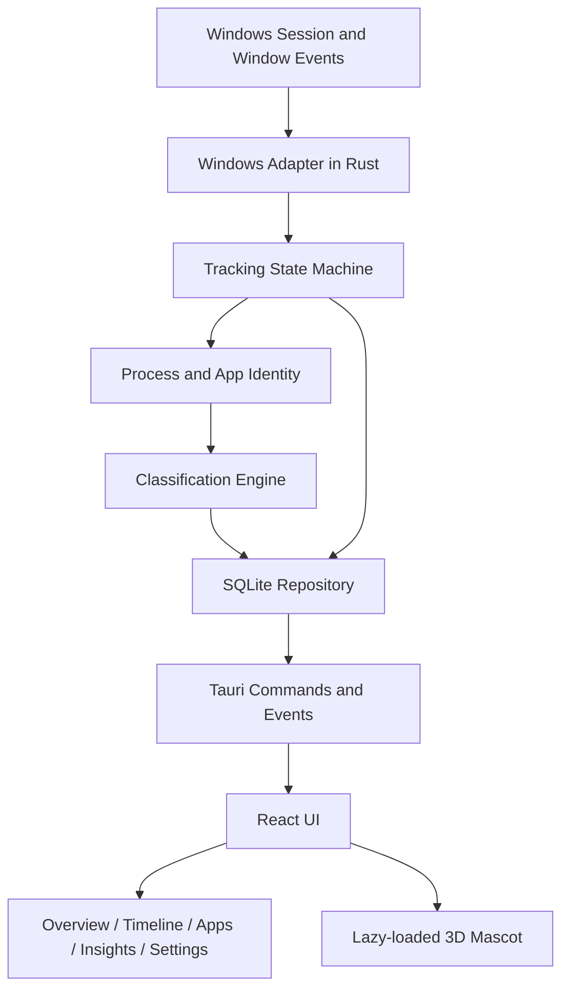

# System Architecture — Timo

## 1. Runtime overview

Timo is a single-user Windows desktop application with a persistent Rust tracking core and a React UI hosted by Tauri.

## 2. Process boundaries

### Windows adapter

- Receives foreground-window events through a WinEvent hook on a dedicated thread with a message loop.
- Resolves HWND to PID and process identity.
- Samples last-input time at a low frequency to enforce configurable idle threshold.
- Receives lock/unlock/session and power suspend/resume signals using the appropriate Windows notification mechanism.
- Emits normalized events to the tracking state machine.

### Tracking state machine

- Maintains current foreground candidate, active session, current idle/locked/suspended state, and last processed event timestamp.
- Debounces noisy focus transitions only as required by tests.
- Uses a monotonic clock for elapsed durations; wall-clock UTC timestamps and timezone metadata are stored on canonical, unsplit sessions (`ADR-001`).
- Daily/midnight segments are derived deterministically at query time against local calendar boundaries (`ADR-001`).
- Flushes sessions and 30s checkpoints transactionally and recovers stale sessions at last reliable checkpoint after restart (`ADR-006`).

### Recognition and classification

- Resolves process/package/manifest evidence into a stable application record.
- Applies user overrides before automatic rules.
- Produces category suggestion, confidence, and evidence provenance.
- Does not send metadata to external AI services.

### Persistence

- Rust owns SQLite access.
- Repository layer exposes typed operations.
- Aggregates are computed from canonical session/event records to avoid inconsistent duplicate totals.

### Tauri bridge

- Commands for dashboard queries, application details, category overrides, settings, export, and delete.
- Events for current tracking status and meaningful updates; avoid high-frequency UI events.
- Validate all command inputs and keep filesystem/database operations in Rust.

### React UI

- Renders pages and charts from typed data.
- Does not poll Windows APIs.
- Does not query all records on every render.
- Keeps mascot scene lazy-loaded and pausable.

## 3. Threading model

- UI/main Tauri runtime: window lifecycle and commands.
- Dedicated native event thread: WinEvent hook/message loop and session/power notification window as required.
- Tracking coordinator: serial event processing to preserve ordering.
- Database writer: serialized writes/transactions; read operations may use controlled separate connections.

Avoid creating multiple competing sources of tracking state. A single coordinator owns session transitions.

## 4. Failure handling

- Hook registration failure: mark tracking unavailable and show a clear status; do not fabricate usage.
- Process access denied/exited: retain partial evidence and close/mark session safely.
- Database error: log redacted diagnostics, keep bounded retry/backoff, and avoid silent data loss.
- Restart/crash: recover open sessions by ending at the last reliable heartbeat/event time; never count the time while Timo was not running as active app time.
- Sleep/resume: close before suspend and re-evaluate foreground after resume.

## 5. Runtime lifecycle (`ADR-005`)

- User launches Timo or Windows starts it through opt-in autostart.
- Tracking initializes independently of the WebView2 window and stays operational without any active `WebviewWindow`.
- When closing to tray (`close_behavior == "tray"`), destroy and recreate the main `WebviewWindow` (`RunEvent::ExitRequested` calls `api.prevent_exit()`) or apply `hide()` + `WebViewExtWindows::set_memory_usage_level(Low)` per Phase 1/3 benchmark measurements (`ADR-005`).
- Quit explicitly sets quit intent, flushes DB checkpoints, and calls `UnhookWinEvent`.
- Autostart is opt-in and clearly shown in Settings.

## 6. Security boundaries

- Tauri capabilities are least privilege.
- No arbitrary shell execution from UI.
- No frontend-provided executable path is trusted for file access.
- Validate app IDs and category values on the Rust side.
- Avoid logging raw window titles or full user paths unless necessary and explicitly redacted.
